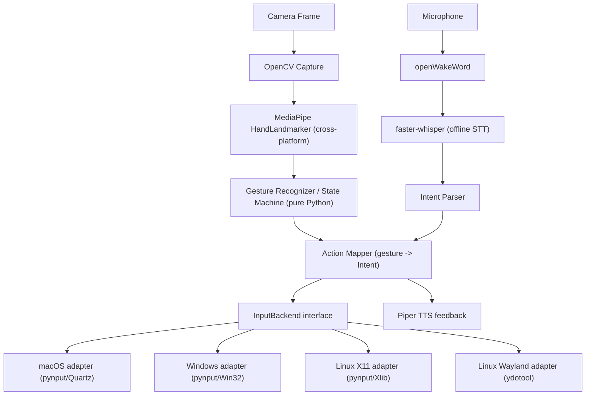

# Product Requirements Document — AI Vision Gesture Control Tool

Status: Draft v1
Owner: (project owner)
Last updated: 2026-09-21

## 1. Problem statement

Most computer input today assumes a user has consistent, fine-motor control of a
physical mouse/trackpad and keyboard. Users with motor impairments, RSI, temporary
injuries, or situational constraints (presenting, cooking, lab work with gloves)
need an alternative input modality that doesn't require touching a device. Existing
gesture tools are either OS-locked, closed-source, or don't treat accessibility as a
first-class use case.

## 2. Product summary

A local-first, privacy-respecting desktop application that lets a user control
mouse/keyboard/navigation actions using **hand gestures** (via webcam) and/or
**voice**, without needing physical mouse/keyboard/touch input. Everything runs
on-device — no video or audio ever leaves the machine.

## 3. Goals

- Reliable, low-latency cursor control via hand tracking, usable with either hand.
- A rich, discoverable gesture vocabulary for clicking, dragging, scrolling,
  zooming, and switching tabs/windows.
- A voice command layer that shares the same action pipeline as gestures, so either
  modality (or both together) can drive the whole app.
- Accessibility-tuned profiles that make the tool genuinely usable — not just
  demoable — for people with limited hand mobility or who can only use one hand.
- One codebase that runs on macOS, Windows, and Linux, not three separate tools.
- Production-grade code quality: typed, documented, tested, and reproducible from a
  clean clone at every milestone.

## 4. Non-goals (v1)

- Mobile OS support (iOS/Android).
- Multi-user or networked/cloud features — this is a single-user local tool.
- Cloud-dependent speech/vision processing — offline-first is a hard requirement.
- Full sign-language recognition (a much larger, separate problem).
- Perfect Wayland parity on Linux (Wayland restricts synthetic input by design; see
  Risks).

## 5. Personas

| Persona | Needs |
|---|---|
| General user | Fun, productive hands-free control for presentations, media playback, or general convenience. |
| Motor-impaired / RSI user | Large gesture tolerance zones, adjustable sensitivity, a non-pinch click alternative (dwell-click), voice as a fallback modality. |
| Low/no hand-use user | Voice-only navigation that can fully replace gestures; no feature should be voice-unreachable. |
| One-handed user | Every core action must be reachable using a single hand — no gesture should require two hands as the *only* path. |

## 6. Cross-platform architecture

**Decision: one toolkit, not one per OS.** The system is layered so that only a
thin "input injection" layer is OS-specific; everything else (vision, gesture
logic, voice, action mapping) is pure Python and runs identically everywhere.

- **Vision layer** — `OpenCV` (capture) + `MediaPipe Tasks` `HandLandmarker`
  (landmarks). MediaPipe ships prebuilt wheels for Windows/macOS/Linux; identical
  code runs on all three.
- **Gesture/state logic layer** — pure Python over normalized landmark
  coordinates; no OS calls, fully unit-testable without hardware.
- **Action Mapper** — translates a recognized gesture *or* a parsed voice
  `Intent` into one call on the `InputBackend` interface. This is the single
  shared contract gestures and voice both go through.
- **InputBackend (the only OS-sensitive layer)** — one interface
  (`move_to`, `click`, `scroll`, `key`, `switch_app`, ...) with adapters:
  - macOS: `pynput`/`pyautogui` (Quartz) — needs Accessibility + Screen Recording
    permission grants.
  - Windows: `pynput`/`pyautogui` (Win32) — works out of the box.
  - Linux X11: `pynput`/`pyautogui` (Xlib) — works out of the box.
  - Linux Wayland: `ydotool`/`ydotoold` (uinput-based), since Wayland blocks
    synthetic input by design; selected at runtime via `XDG_SESSION_TYPE`
    detection.
- **Voice layer** — `openWakeWord` (wake word) -> `faster-whisper` (offline STT)
  -> deterministic intent parser -> `Piper` (offline TTS). All pure-Python/ONNX,
  no OS-specific bindings.

## 7. Feature list

### 7.1 Virtual mouse / cursor (v1)

- Map index-fingertip position to screen cursor position, with a 1€ filter
  (low cutoff at rest, higher cutoff while moving) so jitter is removed
  without lagging a real swipe. An inset active region maps the comfortable
  center of the camera image onto the full screen.
- Works with either hand automatically; optional hand-preference lock setting.
- Click = pinch (thumb + index). Double-click = double-pinch within a time
  window. Right-click = pinch with middle finger. Drag = pinch-and-hold + move.
- **Dwell click** — hovering over a spot for N ms triggers a click; an
  accessibility-first alternative to pinch for users who can't pinch precisely.
- Click-lock / drag-lock toggle for users who struggle to hold a pinch.

### 7.2 Navigation gestures (v1)

- Swipe left/right (open-palm sweep) -> switch tab / switch window / alt-tab.
- Swipe up/down -> scroll.
- Pinch-spread -> zoom in/out (maps to Cmd/Ctrl + `+`/`-`).
- Fist -> pause tracking (reposition hand without moving the cursor) — critical
  usability feature, ships in the same milestone as the virtual mouse.
- Open-palm hold -> "gesture menu" overlay showing available commands
  (discoverability + accessibility).

### 7.3 Voice agent (v1, fully offline)

- Configurable wake word (default "hey gesture") via `openWakeWord`.
- Offline STT via `faster-whisper` (small/base model, CPU).
- Deterministic command grammar first (`"click"`, `"scroll down"`,
  `"switch tab"`, `"pause tracking"`, `"open cursor webpage"`,
  `"open apple website"`, ...) parsed into the same `Intent` shape
  the gesture recognizer produces, so both modalities share one Action Mapper.
  The first shipped phrases open an allowlisted https URL in Google Chrome
  (`IntentType.OPEN_URL` → `InputBackend.open_url`). In-page control of a
  website is a later milestone.
- Offline TTS via `Piper` for confirmations (e.g. "Paused", "Switched tab"),
  toggleable — important for blind/low-vision users.
- **Stretch**: optional local LLM (Ollama) fallback for free-form phrasing, off
  by default (adds a heavy dependency, not required for core UX).

### 7.4 Accessibility features (first-class, not an afterthought)

- Sensitivity / dwell-time / gesture-size **profiles** ("Standard",
  "Limited mobility", "Voice-primary"), saved per user.
- Large, high-contrast on-screen feedback (cursor highlight ring,
  gesture-recognized toast) for users with cognitive/attention differences.
- **Voice-only mode** — full navigation without any hand gestures at all
  ("next", "select", "go back", etc.).
- **One-handed guarantee** — every core action (click, scroll, zoom,
  tab-switch) must be reachable with a single hand; audited explicitly in M6.
- **Configurable gesture remapping** — users can redefine which gesture maps to
  which action, since a "standard" gesture set isn't equally easy for everyone.
- **Calibration wizard** on first run, replacing hard-coded thresholds with a
  per-user comfortable gesture range/webcam FOV.
- Stretch: cursor "sticky snap" to clickable UI elements via platform
  accessibility APIs (flagged as platform-specific, deferred past v1).

### 7.5 Cross-cutting / safety

- Config file (YAML) for thresholds, gesture-to-action bindings, wake word,
  camera index.
- Menu-bar/tray icon: tracking on/off, mic on/off, quick pause hotkey.
- **Safe-pause global hotkey** to instantly disable input injection — mandatory
  safety feature; gesture systems must never get "stuck" moving the mouse. Ships
  starting with the virtual-mouse milestone, not deferred to polish.
- Privacy: no video/audio is ever transmitted off-device; nothing is recorded to
  disk by default.

## 8. Tech stack

- Python 3.11, pinned inside a project-local venv via `scripts/setup_env.sh`,
  independent of whatever system Python is installed (this machine's system
  Python is Homebrew 3.14.7, far newer than these libraries are tested
  against). Verified during M0: Python 3.12.5 has a known CPython `ast`
  module regression that breaks Black's AST safety checks (fixed in 3.12.6),
  so `scripts/setup_env.sh` prefers 3.11 first and falls back to 3.12.
- `opencv-python`, `mediapipe` (`HandLandmarker`), `pynput` + `pyautogui`
  (input injection), `numpy`.
- Voice (optional/lazy-imported so gesture-only usage has no audio dependency):
  `openwakeword`, `faster-whisper`, `piper-tts`.
- Quality tooling: `black` (format), `ruff` (lint/import-sort), `mypy` (types),
  `pytest` (tests) — all configured in `pyproject.toml`.
- Config: `pydantic` (or `dataclasses`) + YAML.

## 9. Engineering conventions

See [`AGENTS.md`](../AGENTS.md) for the full contributor/agent-facing version.
Summary:

- Full type hints on every function; Google-style docstrings on every public
  module/class/function; inline comments on non-obvious logic (thresholds,
  smoothing math, coordinate transforms).
- One responsibility per module; no God-objects.
- No dead code or inline `TODO`s left on `main` — tracked instead in
  `docs/BACKLOG.md`.
- Small, atomic, conventional-commit-style commits; every milestone tagged
  (`git tag mN-<name>`).
- `scripts/check.sh` (lint + type-check + unit tests) must pass before any
  commit is considered done.
- Every milestone: reproducible from a clean clone, has automated tests for its
  pure-logic pieces, has a manual QA checklist entry in
  `docs/QA_CHECKLISTS.md` for hardware-dependent behavior, and updates docs in
  the same commit.

## 10. Milestones

Each milestone below ends in a working, demoable, committed, and tested state.
Order chosen: macOS-first, then generalize to other OSes, then voice, then
accessibility depth, then polish.

1. **M0 — Repo & environment scaffold.**
2. **M1 — Camera + hand landmark pipeline (macOS debug overlay).**
3. **M2 — Virtual mouse v1: cursor mapping + pinch click + safe-pause hotkey (macOS).**
4. **M3 — Gesture vocabulary expansion** (double-click, right-click, drag,
   dwell-click, fist-to-pause, swipe/scroll/zoom).
5. **M4 — Cross-platform `InputBackend` abstraction** (macOS/Windows/Linux X11/
   Linux Wayland).
6. **M5 — Voice agent v1** (wake word + offline STT + shared Action Mapper +
   offline TTS).
7. **M6 — Accessibility layer** (calibration wizard, profiles, one-handed
   audit, remapping).
8. **M7 — Polish & packaging** (tray app, distributable builds, final docs).

Full acceptance criteria and definition-of-done per milestone live in the
project plan; see `docs/QA_CHECKLISTS.md` for the running manual test list and
`docs/BACKLOG.md` for anything explicitly deferred.

## 11. Risks / open items

- macOS requires explicit Accessibility + Screen Recording/Camera permission
  grants for the terminal/app; must fail loudly with a clear remediation
  message, never silently.
- Linux Wayland input injection is restricted by design; support is
  "best effort" via `ydotool` and documented as needing an extra system daemon.
- MediaPipe/`faster-whisper`/`openwakeword` compatibility with very new Python
  versions is unverified; venv will pin to whichever of 3.11/3.12 tests clean.
- Gesture false positives while the user is typing or using a real mouse are
  mitigated by fist-to-pause and the hard safe-pause hotkey, both required from
  M2 onward, not deferred.

## 12. Success metrics (qualitative for v1, no telemetry collected)

- A new user can go from clean clone to controlling their cursor with gestures
  in under 15 minutes, following only `README.md`.
- A "Limited mobility" profile user can complete a full basic browsing session
  (scroll, click, switch tab) using only dwell-click + voice, no pinch required.
- Every milestone's commit history shows small, reviewable, individually
  buildable steps rather than one large drop.
